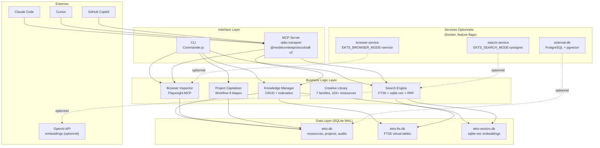

# Architecture Technique — EKTS

**Statut :** ✅ Terminé  
**Date de création :** 21 octobre 2026  
**Dernière mise à jour :** 21 octobre 2026  
**Version :** 1.0  
**Auteur :** Agent EKTS  
**Documents sources :**
- `07-Architecture-and-Roadmap/13_ARCHITECTURES_CIBLES_COMPAREES.md`
- `04-Knowledge/06_ARCHITECTURE_STOCKAGE.md`
- `04-Knowledge/06_MODELE_DONNEES.md`
- `07-Architecture-and-Roadmap/13_SPECIFICATION_MVP.md`
- `02-Agent-Integration/02_MCP_ET_AGENTS.md`
- `02-Agent-Integration/03_CONCEPTION_OUTILS_ET_SERVICES.md`

---

## 1. Objectif du document

Ce document décrit l'architecture technique cible d'EKTS. Il sert de référence pour l'implémentation et permet à un agent de développement futur de comprendre la structure du système sans relire l'ensemble des documents de phase.

**Ce que ce document n'est pas :**
- Un document de spécification exhaustive (renvoi vers les documents sources)
- Un guide d'implémentation (renvoi vers les dossiers de sprint en PARTIE II)
- Une représentation du système tel qu'il existe aujourd'hui (le code n'existe pas encore)

---

## 2. Choix architectural

### 2.1 Décision

**Architecture C (Hybride)** — Monolithe modulaire TypeScript/Node.js avec SQLite WAL, extensible par services optionnels activés via feature flags.

**Référence :** ADR-005 (VALIDÉ)  
**Date de décision :** Phase 13 (21 octobre 2026)

### 2.2 Justification

| Critère | Poids | Score A (Monolithe) | Score B (Microservices) | Score C (Hybride) |
|---------|-------|---------------------|-------------------------|-------------------|
| Complexité | 20% | 9/10 | 3/10 | 7/10 |
| Coût | 15% | 10/10 | 3/10 | 9/10 |
| Maintenance | 20% | 9/10 | 4/10 | 7/10 |
| Sécurité | 15% | 9/10 | 6/10 | 8/10 |
| Portabilité | 15% | 10/10 | 4/10 | 9/10 |
| Évolutivité | 15% | 4/10 | 9/10 | 8/10 |
| **TOTAL** | 100% | **8.5/10** | **4.8/10** | **8.0/10** |

**Choix :** Architecture C (8.0/10) pour son compromis pragmatique entre simplicité initiale et capacité d'évolution.

### 2.3 Alternatives écartées

**Architecture A (Monolithe pur) — 8.5/10 :**
- Écartée car : pas de chemin d'évolution vers la distribution si le besoin apparaît
- Avantage : plus simple que C
- Inconvénient majeur : dead-end si scaling nécessaire

**Architecture B (Microservices) — 4.8/10 :**
- Écartée car : complexité disproportionnée pour un usage personnel/équipe petite
- Avantage : scaling horizontal
- Inconvénient majeur : coût infrastructure, maintenance multi-langages

### 2.4 Phases d'évolution

| Phase | Période | Architecture | Trigger |
|-------|---------|--------------|---------|
| Phase 1 | Mois 1-3 | Monolithe SQLite (A) | MVP |
| Phase 2 | Mois 4-6 | + services optionnels | Inspection lourde, volume > 100K docs |
| Phase 3 | Mois 7-12 | Distribution si requis | Multi-users, SLA 24/7 |

**Critères de migration A → B :**
- Volume > 50K documents (search-service)
- Inspection > 10 sites/jour (browser-service)
- Latence > 500ms persistante (optimisation requise)

**Critères de migration B → C :**
- Multi-users requis (> 5 devs simultanés)
- Production 24/7 avec SLA
- Scaling horizontal nécessaire

---

## 3. Vue d'ensemble du système

### 3.1 Diagramme d'architecture



### 3.2 Flux de données principaux

**Flux 1 — Recherche hybride :**
```
User/Agent → Query → Search Engine
  ├→ FTS5 (BM25) → top 20 résultats textuels
  ├→ sqlite-vec (cosine) → top 20 résultats sémantiques
  └→ RRF fusion (k=60) → top 10 résultats hybrides
```

**Flux 2 — Ajout de ressource :**
```
User/Agent → Données ressource → Knowledge Manager
  ├→ Validation (Zod)
  ├→ Stockage SQLite (ekts.db)
  ├→ Génération embedding (OpenAI/Ollama)
  ├→ Indexation FTS5 (ekts-fts.db)
  └→ Indexation vectorielle (ekts-vectors.db)
```

**Flux 3 — Inspection de site :**
```
URL → CLI/MCP → Browser Inspector
  ├→ Playwright MCP (navigation, screenshot, trace)
  ├→ Analyse 5 dimensions (perf, a11y, SEO, UX, contenu)
  ├→ Calcul matrice sévérité
  └→ Stockage audit + indexation RAG
```

---

## 4. Composants détaillés

### 4.1 Interface Layer

#### 4.1.1 CLI (Commander.js)

**Rôle :** Interface en ligne de commande pour utilisateurs et scripts  
**Statut :** 🟡 Prévu dans MVP-1 (Sprint 5)  
**Technologie :** Commander.js v12+  
**Responsabilités :**
- Parser arguments et options
- Valider entrées (Zod)
- Appeler Business Logic
- Formater sortie (JSON ou humain)
- Gérer codes de sortie

**Commandes MVP-1 :**
```
ekts init              # Initialise les 3 bases SQLite
ekts add <resource>    # Ajoute une ressource
ekts search <query>    # Recherche hybride
ekts get <id>          # Obtient ressource par ID
ekts list [filters]    # Liste ressources
ekts delete <id>       # Supprime ressource
ekts status            # Affiche statut système
```

**Commandes MVP-2 (ajoutées) :**
```
ekts inspect <url> --level L1|L2|L3   # Inspection navigateur
```

**Commandes MVP-3 (ajoutées) :**
```
ekts capitalize <path>                # Capitalisation projet
```

#### 4.1.2 MCP Server

**Rôle :** Exposition des capacités EKTS aux agents IA  
**Statut :** 🟡 Prévu dans MVP-1 (Sprint 6)  
**Technologie :** @modelcontextprotocol/sdk v2  
**Transport :** stdio (local, sécurisé)  
**Spécification :** MCP 2026-07-28 (stateless)

**Outils MVP-1 (4 prioritaires) :**

| Outil | Rôle | Entrées | Sorties |
|-------|------|---------|---------|
| `search_knowledge` | Recherche hybride | `query: string`, `limit?: number`, `mode?: 'hybrid'\|'fts'\|'vector'` | `results: SearchResult[]` |
| `get_resource` | Obtenir ressource | `id: string` | `resource: Resource \| null` |
| `list_resources` | Lister ressources | `filters?: { type?, tags?, limit? }` | `resources: Resource[]` |
| `validate_resource` | Valider schéma | `data: unknown` | `{ valid: boolean, errors?: string[] }` |

**Outils MVP-2 (ajoutés) :**
- `inspect_site` — Inspection navigateur

**Outils MVP-3 (ajoutés) :**
- `capitalize_project` — Capitalisation projet

### 4.2 Business Logic Layer

#### 4.2.1 Knowledge Manager

**Rôle :** Gestion CRUD des ressources et orchestration de l'indexation  
**Statut :** 🟡 Prévu dans MVP-1 (Sprint 3)  
**Responsabilités :**
- Validation des entrées (Zod schemas)
- CRUD ressources (via Repository pattern)
- Orchestration indexation (FTS + Vector)
- Gestion des métadonnées et tags

**Interfaces :**
```typescript
interface IKnowledgeManager {
  addResource(input: AddResourceInput): Promise<Resource>;
  getResource(id: string): Promise<Resource | null>;
  listResources(filters?: ResourceFilters): Promise<Resource[]>;
  updateResource(id: string, data: Partial<Resource>): Promise<Resource>;
  deleteResource(id: string): Promise<void>;
}
```

#### 4.2.2 Search Engine

**Rôle :** Recherche hybride (FTS + Vector + RRF)  
**Statut :** 🟡 Prévu dans MVP-1 (Sprint 4)  
**Responsabilités :**
- Recherche full-text via FTS5 (BM25)
- Recherche vectorielle via sqlite-vec (cosine similarity)
- Fusion des résultats via RRF (Reciprocal Rank Fusion, k=60)
- Génération d'embeddings (OpenAI ou Ollama)

**Algorithme RRF :**
```
score_rrf(d) = Σ 1/(k + rank_i(d))
  où k = 60 (constante de lissage)
  et rank_i(d) = rang du document d dans la liste i
```

**Cibles performance :**
- Recall@5 ≥ 0.75
- Faithfulness ≥ 0.80
- Latence < 500ms (100K documents)

#### 4.2.3 Browser Inspector

**Rôle :** Inspection automatisée de sites web  
**Statut :** 🟡 Prévu dans MVP-2 (Sprint 7-10)  
**Technologie :** Playwright + Playwright MCP  
**Responsabilités :**
- Navigation et captures (screenshots, traces)
- Extraction accessibility tree
- Analyse 5 dimensions
- Calcul matrice sévérité

**Niveaux d'inspection :**

| Niveau | Contenu | Durée cible |
|--------|---------|-------------|
| L1 (Rapide) | Screenshot + accessibility tree | < 10s |
| L2 (Standard) | L1 + Lighthouse + SEO | < 30s |
| L3 (Approfondie) | L2 + UX + contenu | < 60s |
| L4 (Crawling) | L3 + multi-pages | MVP-2 exclu |

**5 dimensions d'analyse :**
1. Performance (Lighthouse)
2. Accessibilité (axe-core, WCAG 2.2 AA)
3. SEO (meta tags, structured data)
4. UX (heuristiques Nielsen)
5. Contenu (qualité, pertinence)

#### 4.2.4 Creative Library

**Rôle :** Gestion des ressources créatives (7 familles)  
**Statut :** 🟡 Reporté (optionnel, MVP-1.5)  
**Source :** Phase 09  
**Familles :**
1. UI (composants, design systems)
2. Motion (GSAP, Framer Motion)
3. 3D (Three.js, R3F, shaders)
4. Data Viz (Recharts, D3)
5. Procédural (generative art)
6. Math/Physique (simulations)
7. Tests (visual testing)

#### 4.2.5 Project Capitalizer

**Rôle :** Workflow de capitalisation des projets terminés  
**Statut :** 🟡 Prévu dans MVP-3 (Sprint 13-18)  
**Source :** Phase 10  
**Workflow 8 étapes :**
1. Collecte artefacts
2. Nettoyage secrets (Gitleaks + TruffleHog)
3. Documentation
4. Vérification
5. Validation (humaine)
6. Publication (Git)
7. Indexation (FTS + Vector)
8. Dépréciation (si nécessaire)

### 4.3 Data Layer

#### 4.3.1 Architecture 3 bases SQLite

**Décision :** Séparation en 3 fichiers pour isolation des préoccupations  
**Référence :** ADR-001 (VALIDÉ)

| Base | Rôle | Contenu principal |
|------|------|-------------------|
| `ekts.db` | Données structurées | Tables `resources`, `projects`, `audits`, `creative_resources` |
| `ekts-fts.db` | Full-text search | Tables virtuelles FTS5, BM25 scoring |
| `ekts-vectors.db` | Search vectorielle | Tables sqlite-vec, embeddings, cosine similarity |

**Configuration SQLite :**
```sql
PRAGMA journal_mode = WAL;        -- Write-Ahead Logging (perf)
PRAGMA synchronous = NORMAL;       -- Équilibre perf/sécurité
PRAGMA foreign_keys = ON;          -- Intégrité référentielle
PRAGMA cache_size = -64000;        -- 64 MB cache
PRAGMA temp_store = MEMORY;        -- Temp en mémoire
```

#### 4.3.2 Modèle de données

**Table `resources` (ekts.db) :**
```sql
CREATE TABLE resources (
  id TEXT PRIMARY KEY,                    -- UUID
  type TEXT NOT NULL CHECK(type IN ('article','video','tutorial','tool','other')),
  title TEXT NOT NULL,
  url TEXT,
  tags TEXT NOT NULL DEFAULT '[]',        -- JSON array
  metadata TEXT DEFAULT '{}',             -- JSON object
  content TEXT,                           -- Pour indexation
  embedding_model TEXT,                   -- Modèle d'embedding utilisé
  created_at TEXT NOT NULL,               -- ISO 8601
  updated_at TEXT NOT NULL                -- ISO 8601
);
```

**Table `resources_fts` (ekts-fts.db) :**
```sql
CREATE VIRTUAL TABLE resources_fts USING fts5(
  title, content, tags,
  content='resources',
  content_rowid='rowid',
  tokenize='porter unicode61'
);
```

**Table `resources_vectors` (ekts-vectors.db) :**
```sql
-- Utilise l'extension sqlite-vec
CREATE VIRTUAL TABLE resources_vectors USING vec0(
  resource_id TEXT PRIMARY KEY,
  embedding float[1536]                   -- OpenAI text-embedding-3-small
);
```

#### 4.3.3 Repository Pattern

**Interface générique :**
```typescript
interface Repository<T> {
  create(entity: T): Promise<T>;
  getById(id: string): Promise<T | null>;
  list(filters?: Partial<T>): Promise<T[]>;
  update(id: string, data: Partial<T>): Promise<T>;
  delete(id: string): Promise<void>;
}
```

**Implémentation :**
- `ResourceRepository` — CRUD resources
- `AuditRepository` — CRUD audits (MVP-2)
- `ProjectRepository` — CRUD projects (MVP-3)

### 4.4 Services Optionnels

**Activation via feature flags (variables d'environnement) :**

```bash
# Mode navigateur
EKTS_BROWSER_MODE=local       # Défaut : Playwright embarqué
EKTS_BROWSER_MODE=service     # Service Docker séparé

# Mode recherche
EKTS_SEARCH_MODE=sqlite       # Défaut : SQLite + sqlite-vec
EKTS_SEARCH_MODE=postgres     # PostgreSQL + pgvector

# Mode base de données
EKTS_DB_MODE=sqlite           # Défaut : SQLite embedded
EKTS_DB_MODE=postgres         # PostgreSQL externe

# Mode déploiement
EKTS_DEPLOYMENT=standalone    # Défaut : processus unique
EKTS_DEPLOYMENT=distributed   # Services distribués
```

---

## 5. Interfaces et contrats

### 5.1 Contrats TypeScript

**Resource (entité centrale) :**
```typescript
interface Resource {
  id: string;                          // UUID v4
  type: 'article' | 'video' | 'tutorial' | 'tool' | 'other';
  title: string;                       // Min 1 caractère
  url?: string;                        // URL valide optionnelle
  tags: string[];                      // Tags
  metadata?: Record<string, unknown>;  // Métadonnées libres
  content?: string;                    // Contenu pour indexation
  embeddingModel?: string;             // Modèle d'embedding utilisé
  createdAt: string;                   // ISO 8601
  updatedAt: string;                   // ISO 8601
}
```

**SearchResult (résultat de recherche) :**
```typescript
interface SearchResult {
  resource: Resource;
  score: number;                       // Score RRF (hybrid), BM25 (fts), cosine (vector)
  highlight?: string;                  // Extrait avec termes surlignés
  source: 'fts' | 'vector' | 'hybrid'; // Source du résultat
}
```

**Audit (MVP-2) :**
```typescript
interface Audit {
  id: string;
  url: string;
  level: 'L1' | 'L2' | 'L3' | 'L4';
  findings: Finding[];
  createdAt: string;
}

interface Finding {
  dimension: 'performance' | 'accessibility' | 'seo' | 'ux' | 'content';
  severity: number;     // 0-4
  frequency: number;    // 1-5
  impact: number;       // 1-3
  priority: number;     // severity × frequency × impact
  title: string;
  description: string;
  recommendation: string;
}
```

### 5.2 Validation (Zod)

**Schémas de validation :**
```typescript
import { z } from 'zod';

const ResourceSchema = z.object({
  id: z.string().uuid(),
  type: z.enum(['article', 'video', 'tutorial', 'tool', 'other']),
  title: z.string().min(1),
  url: z.string().url().optional(),
  tags: z.array(z.string()),
  metadata: z.record(z.unknown()).optional(),
  content: z.string().optional(),
  createdAt: z.string().datetime(),
  updatedAt: z.string().datetime(),
});

const SearchQuerySchema = z.object({
  query: z.string().min(1),
  limit: z.number().int().positive().default(10),
  mode: z.enum(['hybrid', 'fts', 'vector']).default('hybrid'),
});
```

---

## 6. Déploiement et environnement

### 6.1 Environnements

| Environnement | Période | Infrastructure |
|---------------|---------|----------------|
| **Développement** | Mois 1-9 | Local (Node.js + SQLite) |
| **Production personnelle** | Mois 9+ | Local ou VPS léger |
| **Production équipe** | Si requis | Docker Compose + PostgreSQL |

### 6.2 Prérequis système

**Minimum :**
- Node.js 20+ (LTS)
- npm 10+
- 4 GB RAM
- 1 GB espace disque
- OS : Linux, macOS, Windows (WSL2 recommandé)

**Recommandé :**
- Node.js 22 LTS
- 8 GB RAM
- SSD pour bases SQLite
- GPU (si embeddings locaux via Ollama)

### 6.3 Structure du dépôt (prévue)

```
ekts/
├── src/
│   ├── cli/                # CLI Commander.js
│   ├── mcp/                # MCP Server + tools
│   ├── business/           # Business Logic
│   │   ├── knowledge-manager.ts
│   │   ├── search-engine.ts
│   │   ├── browser-inspector.ts   # MVP-2
│   │   └── project-capitalizer.ts # MVP-3
│   ├── data/               # Data Layer
│   │   ├── repositories/
│   │   ├── schemas/
│   │   └── migrations/
│   └── shared/             # Utils, types, config
├── tests/
│   ├── unit/
│   ├── integration/
│   └── benchmark/
├── docs/
├── migrations/
├── package.json
├── tsconfig.json
├── vitest.config.ts
└── .env.example
```

---

## 7. Considérations techniques

### 7.1 Performance

**Optimisations prévues :**
- SQLite WAL pour lectures parallèles
- Batch processing pour indexation
- Connection pooling (si PostgreSQL en Phase 3)
- Cache LRU pour requêtes fréquentes
- Index composites pour filtres courants

**Monitoring :**
- Latence par opération (P50, P95, P99)
- Taille bases SQLite
- Nombre ressources/audits/projects
- Taux de succès recherche (Recall@5, Faithfulness)

### 7.2 Évolutivité

**Chemins d'évolution :**
1. **Vertical** : Augmenter RAM/CPU machine
2. **Horizontal** : Services Docker optionnels
3. **Distribution** : PostgreSQL + pgvector si multi-users

**Limites connues :**
- SQLite : écritures séquentielles (WAL permet lectures parallèles)
- sqlite-vec : recommandé < 100K vecteurs
- FTS5 : performant jusqu'à plusieurs millions de documents

### 7.3 Portabilité

**Garanties :**
- Fichiers SQLite copiables (backup trivial)
- Pas de dépendances système (SQLite embedded)
- Multi-plateforme (Linux, macOS, Windows)
- Formats exportables (JSON, CSV)

---

## 8. Sécurité

### 8.1 Niveaux de sécurité

**Niveau 1 — MVP (Local) :**
- Fichiers SQLite `chmod 600`
- Pas d'exposition réseau (stdio uniquement)
- Secrets dans `.env` (jamais commités)
- Gitleaks pre-commit hook

**Niveau 2 — Équipe (LAN) :**
- MCP server sur LAN (IP whitelist)
- Authentification basique (API key)
- Audit logs
- Backup quotidien

**Niveau 3 — Production (Internet) :**
- HTTPS obligatoire
- Authentification OAuth2/JWT
- RBAC
- Rate limiting
- Firecracker microVMs

### 8.2 Menaces STRIDE (adaptées MCP)

| Menace | Mitigation MVP | Mitigation Production |
|--------|----------------|----------------------|
| Spoofing | Local-only, stdio | OAuth2 + JWT |
| Tampering | Fichiers locaux | HTTPS + signatures |
| Repudiation | Logs locaux | Audit logs centralisés |
| Info Disclosure | chmod 600 | Chiffrement at-rest + in-transit |
| DoS | Pas d'exposition | Rate limiting, DDoS protection |
| Elevation of Privilege | Single-user | RBAC, moindre privilège |

**Référence complète :** `06-Security/11_MODELE_DE_MENACE.md`

---

## 9. Surveillance et maintenance

### 9.1 Logs

**Technologie :** Pino (JSON structuré)  
**Niveaux :**
- `error` — Erreurs critiques
- `warn` — Anomalies non bloquantes
- `info` — Opérations importantes
- `debug` — Debug détaillé (désactivé en production)

### 9.2 Métriques

**Métriques clés :**
- Latence CLI (< 200ms objectif)
- Latence recherche (< 500ms objectif)
- Couverture tests (> 80% objectif)
- Nombre ressources/audits/projects
- Taux erreur

### 9.3 Sauvegarde

**Stratégie MVP :**
- Copie fichiers SQLite (quotidienne, cron)
- Rétention 30 jours
- 1 copie hors-site (optionnel)

**Référence complète :** `07-Architecture-and-Roadmap/14_PLAN_MAINTENANCE_ET_VEILLE.md`

---

## 10. Résumé des états des composants

| Composant | État | Sprint | Commentaire |
|-----------|------|--------|-------------|
| CLI (Commander.js) | 🟡 Prévu MVP-1 | Sprint 5 | 7 commandes |
| MCP Server (stdio) | 🟡 Prévu MVP-1 | Sprint 6 | 4 outils prioritaires |
| Knowledge Manager | 🟡 Prévu MVP-1 | Sprint 3 | CRUD + indexation |
| Search Engine | 🟡 Prévu MVP-1 | Sprint 4 | FTS + Vector + RRF |
| SQLite WAL | 🟡 Prévu MVP-1 | Sprint 2 | 3 bases |
| Repository Pattern | 🟡 Prévu MVP-1 | Sprint 2 | Abstraction Data Layer |
| Browser Inspector | 🟡 Prévu MVP-2 | Sprint 7-10 | Playwright MCP |
| Creative Library | ⚪ Reporté | MVP-1.5 optionnel | 7 familles |
| Project Capitalizer | 🟡 Prévu MVP-3 | Sprint 13-18 | Workflow 8 étapes |
| browser-service | ⚪ Optionnel | Si requis | Docker, feature flag |
| search-service | ⚪ Optionnel | Si requis | Python + embeddings |
| external-db | ⚪ Optionnel | Si multi-users | PostgreSQL + pgvector |

**Légende :**
- 🟢 Existant et vérifié : N/A (pas encore d'implémentation)
- 🟡 Prévu dans le MVP : Planifié, non implémenté
- 🔵 Prévu pour phase ultérieure : Post-MVP
- ⚪ Optionnel : Activé par feature flag si besoin

---

## 11. Références

### 11.1 Documents sources

- `07-Architecture-and-Roadmap/13_ARCHITECTURES_CIBLES_COMPAREES.md` — Comparatif 3 architectures
- `07-Architecture-and-Roadmap/13_SPECIFICATION_MVP.md` — Périmètre MVP, contrats
- `04-Knowledge/06_ARCHITECTURE_STOCKAGE.md` — Architecture SQLite
- `04-Knowledge/06_MODELE_DONNEES.md` — Modèle de données complet
- `02-Agent-Integration/02_MCP_ET_AGENTS.md` — Spécification MCP
- `02-Agent-Integration/03_CONCEPTION_OUTILS_ET_SERVICES.md` — Principes de conception

### 11.2 Décisions associées

- ADR-001 : SQLite WAL + FTS5 + sqlite-vec
- ADR-002 : 4 outils MCP prioritaires
- ADR-003 : Playwright pour inspection
- ADR-004 : Recherche hybride FTS + Vector + RRF
- ADR-005 : Architecture C Hybride
- ADR-009 : MCP transport stdio
- ADR-010 : Validation Zod

---

**Document rédigé le 21 octobre 2026 — PARTIE I du projet EKTS**  
**Statut : ✅ Document de référence architectural**
