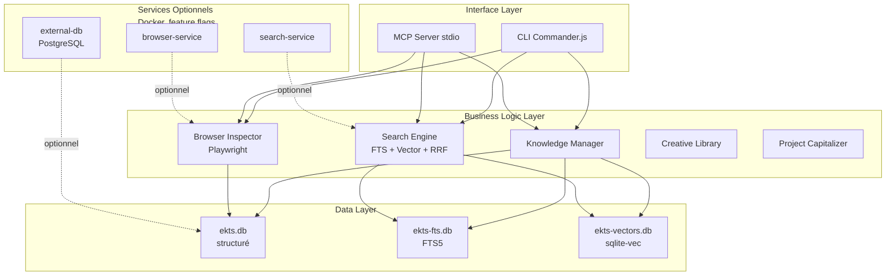

# RÉFÉRENCE GLOBALE — Engineering Knowledge & Tooling System (EKTS)

**Statut :** ✅ Document de référence principal  
**Date de création :** 21 octobre 2026  
**Dernière mise à jour :** 21 octobre 2026  
**Version :** 1.0  
**Auteur :** Agent EKTS (consolidation des phases 00-14)  
**Blueprint source :** v1.0 (21 octobre 2026)

---

## Comment utiliser ce document

Ce document est le **point d'entrée unique** du projet EKTS. Il consolide l'ensemble des recherches, analyses, décisions et recommandations produites durant 15 phases de recherche (phases 00 à 14).

**Ce document ne remplace pas les documents de phase.** Il les référence et permet de retrouver rapidement l'information détaillée.

**Niveaux de confiance utilisés :**
- ✅ **FAIT VÉRIFIÉ** : Source officielle, benchmark, documentation consultée
- ⚠️ **AFFIRMATION FOURNISSEUR** : Documentation officielle non vérifiée indépendamment
- 🔄 **RETOUR COMMUNAUTÉ** : Benchmarks communautaires, forums, discussions
- 💡 **INFÉRENCE** : Déduction logique à partir de faits vérifiés
- ❓ **NON VÉRIFIÉ** : Information non vérifiable dans l'environnement actuel

---

## TABLE DES MATIÈRES

1. [Vision et finalité](#1-vision-et-finalité)
2. [Historique des recherches](#2-historique-des-recherches)
3. [Besoins fonctionnels](#3-besoins-fonctionnels)
4. [Architecture cible](#4-architecture-cible)
5. [Stack technique consolidée](#5-stack-technique-consolidée)
6. [Inventaire des outils et services](#6-inventaire-des-outils-et-services)
7. [Flux opérationnels](#7-flux-opérationnels)
8. [Roadmap initiale](#8-roadmap-initiale)
9. [Décisions et points ouverts](#9-décisions-et-points-ouverts)
10. [Risques et mesures de maîtrise](#10-risques-et-mesures-de-maîtrise)
11. [Indicateurs de réussite](#11-indicateurs-de-réussite)
12. [Documents complémentaires](#12-documents-complémentaires)

---

## 1. Vision et finalité

### 1.1 Problème initial

À chaque nouveau projet, un développeur ou un agent IA perd du temps à :
- Retrouver les mêmes ressources
- Réexpliquer les mêmes standards
- Rechercher des composants
- Reconstruire des scripts
- Refaire des analyses visuelles
- Répéter des solutions déjà découvertes

**Source :** Blueprint v1.0, §1.1

### 1.2 Vision du système

Construire un environnement personnel, local-first lorsque c'est pertinent, qui centralise et organise :

1. **Connaissances** — méthodes, normes, tutoriels, décisions, notes
2. **Ressources** — bibliothèques, composants, modèles, exemples, outils
3. **Capacités exécutables** — scripts, services, CLI, API, outils MCP
4. **Observation** — inspection de sites, captures, parcours utilisateur
5. **Mémoire de projet** — contexte, décisions, résultats, leçons
6. **Accès agentique** — interface standardisée pour agents IA (MCP)
7. **Amélioration continue** — chaque réalisation enrichit la bibliothèque après validation

**Source :** Blueprint v1.0, §1.2

### 1.3 Proposition de valeur

> « Ne pas repartir de zéro : retrouver, comprendre, exécuter, vérifier et capitaliser sur ce qui a déjà été appris ou construit. »

### 1.4 Objectifs

**Court terme (MVP-1, Mois 1-3) :**
- Bibliothèque locale de ressources structurées
- Recherche hybride (FTS + Vector)
- CLI avec 7 commandes
- Serveur MCP local (4 outils)
- Compatible agents Tier 1 (Claude Code, Cursor, Copilot)

**Moyen terme (MVP-2, Mois 4-6) :**
- Inspection navigateur automatisée (Playwright)
- Analyse 5 dimensions (performance, accessibilité, SEO, UX, contenu)
- Stockage et indexation des audits

**Long terme (MVP-3, Mois 7-9) :**
- Capitalisation de projets (workflow 8 étapes)
- Détection de secrets (Gitleaks + TruffleHog)
- Post-mortems structurés (10 sections)

**Source :** Phases 12-13, Blueprint v1.0 §10

### 1.5 Périmètre du MVP

**Inclus dans MVP-1 :**
- ✅ Stockage structuré (SQLite WAL, 3 bases)
- ✅ Recherche hybride (FTS5 + sqlite-vec + RRF)
- ✅ CLI (7 commandes : init, add, search, get, list, delete, status)
- ✅ MCP Server (4 outils : search_knowledge, get_resource, list_resources, validate_resource)
- ✅ Indexation automatique (FTS + Vector)

**Exclus de MVP-1 :**
- ❌ Creative Library (Phase 09) — reporté
- ❌ Browser Inspector (Phase 04) — MVP-2
- ❌ Project Capitalizer (Phase 10) — MVP-3
- ❌ Authentification / RBAC — Production
- ❌ Monitoring / Alertes — Production

**Source :** Phase 13, `13_SPECIFICATION_MVP.md`

### 1.6 Principes directeurs

1. **Réutiliser avant de reconstruire** — chercher dans le patrimoine existant
2. **Connaissance vérifiable** — conserver sources, date, licence, contexte, confiance
3. **Outils composables** — capacités petites, testables, combinables
4. **L'agent découvre les capacités** — outils décrits clairement (entrées, sorties, limites)
5. **Humain responsable** — revue obligatoire pour actions destructrices
6. **Qualité mesurée** — tester exactitude, accessibilité, performance, sécurité
7. **Pas de technologie pour l'effet** — outil le plus simple qui satisfait le besoin
8. **Séparation des préoccupations** — connaissances, exécution, orchestration, stockage, interface
9. **Capitalisation contrôlée** — projets terminés → références après validation
10. **Évolutivité sans dépendance excessive** — formats exportables, interfaces documentées

**Source :** Blueprint v1.0, §2

### 1.7 Ce que le produit n'est pas

- ❌ Pas seulement une bibliothèque de prompts
- ❌ Pas uniquement un agrégateur de liens
- ❌ Pas un clone de navigateur ou de scraper
- ❌ Pas un agent autonome sans contrôle
- ❌ Pas une collection de composants qui impose le même design
- ❌ Pas une promesse de reproduction exacte de n'importe quel site
- ❌ Pas un système qui archive automatiquement toute sortie

**Source :** Blueprint v1.0, §1.4

---

## 2. Historique des recherches

### 2.1 Vue d'ensemble des phases

**15 phases exécutées** (Phases 00 à 14), produisant **37 livrables numérotés + 14 bilans (51 fichiers)** (~1.5 MB de documentation).

| Phase | Titre | Livrables | Décisions clés | Statut |
|-------|-------|-----------|----------------|--------|
| **00** | Cadrage et stratégie | 3 | Architecture en couches, MVP séquencés | ✅ |
| **01** | Fondations techniques | 2 | Parcours 6 niveaux, JS/TS flexible | ✅ |
| **02** | MCP et intégration agentique | 2 | MCP spec 2026-07-28, SDK TS 1.32.x, stdio | ✅ |
| **03** | Conception d'outils et services | 2 | 5 principes, Zod, Pino, monorepo | ✅ |
| **04** | Automatisation navigateur | 3 | Playwright (96/100), 4 niveaux inspection | ✅ |
| **05** | Scraping responsable | 2 | 5 principes éthiques, règle d'or, hiérarchie | ✅ |
| **06** | Stockage et connaissances | 3 | SQLite WAL, FTS5, sqlite-vec, 3 bases | ✅ |
| **07** | RAG et recherche sémantique | 2 | Recherche hybride, Recall@5≥0.75 | ✅ |
| **08** | Analyse de l'expérience | 2 | 5 dimensions, matrice sévérité | ✅ |
| **09** | Bibliothèque créative | 3 | 7 familles, 103+ ressources, gouvernance | ✅ |
| **10** | Capitalisation projets | 2 | Workflow 8 étapes, post-mortem 10 sections | ✅ |
| **11** | Sécurité et gouvernance | 2 | 4 niveaux sécurité, STRIDE MCP, 38 vecteurs | ✅ |
| **12** | Outils IA, plans gratuits | 3 | Claude Code, Copilot, MCP Tier 1, 54 services | ✅ |
| **13** | Architecture cible, MVP, roadmap | 4 | Architecture C Hybride, 18 sprints, 9 mois | ✅ |
| **14** | Audit final et maintenance | 2 | Score 100% (90/90), plan maintenance | ✅ |

### 2.2 Contributions déterminantes par phase

**Phase 00 — Cadrage :**
- Analyse du blueprint source
- Identification des 8 domaines fonctionnels (A-H)
- Plan de recherche en 15 phases (15 exécutées)
- Glossaire technique (24 KB)

**Phase 02 — MCP :**
- Spécification MCP 2026-07-28 comme référence (Linux Foundation)
- SDK TypeScript 1.32.x comme choix principal (aucune v2 publiée au 21/10/2026 — ADR-011)
- Transport stdio pour MVP (local, sécurisé)
- 4 outils MCP prioritaires : search, get, list, validate
- Matrice compatibilité clients MCP

**Phase 04 — Navigateur :**
- Playwright comme solution principale (score 96/100)
- Patchright comme option stealth (Cloudflare, DataDome)
- Playwright MCP (70+ tools, accessibility tree)
- 4 niveaux d'inspection (L1 rapide → L4 crawling)
- Benchmark reproductible (10 tests)

**Phase 06 — Stockage :**
- SQLite WAL (performance 80x vs lectures simples)
- FTS5 pour full-text (compétitif PostgreSQL tsvector)
- sqlite-vec pour embeddings (<100K vectors)
- Architecture 3 bases séparées
- Compliance GDPR intégrée (retention, anonymisation)

**Phase 11 — Sécurité :**
- 4 niveaux sécurité (MVP → Production)
- 11 domaines de sécurité couverts
- STRIDE adapté MCP (38 vecteurs d'attaque)
- Default-deny network egress
- Firecracker pour Production (hardware isolation)
- LlamaFirewall pour prompt injection

**Phase 12 — Outils IA :**
- Claude Code : meilleure performance (80.8% SWE-bench)
- GitHub Copilot : meilleur rapport qualité/prix ($10/mois)
- Cline + BYOK : confidentialité maximale
- MCP standard émergent (Linux Foundation, 10+ agents Tier 1)
- GitHub Student Pack : 80+ outils gratuits ($2,000+/an)

**Phase 13 — Architecture :**
- Architecture C Hybride choisie (score 8.0/10)
- Séquence MVP validée : MVP-1 → MVP-2 → MVP-3
- Timeline 9 mois, 18 sprints
- Critères mesurables : Recall@5≥0.75, latence<500ms, couverture>80%

**Phase 14 — Audit :**
- Audit 9 dimensions : score 100% (90/90)
- Plan maintenance : 640h/an + $600/an
- Veille technologique : mensuelle/trimestrielle/semestrielle

### 2.3 Ressources antérieures intégrées

**Recherche DRI (Digital Resource Inventory) :**
- 12 documents, 177 ressources gratuites
- Couvre Domaine A (bibliothèque de connaissances)
- Fichiers : `Docs/Référence/dri/`

**Recherche Students :**
- 54 services avec plans étudiants
- 39 éligibles au Bénin
- Valeur totale : ~$7,200/an
- Fichiers : `Docs/Référence/students/`

**Recherche HarnAI :**
- 28 outils harness IA catalogués
- 7 familles d'outils
- Compatibilité MCP évaluée
- Fichiers : `Docs/Référence/harnai/`

**Documents Digital Experience :**
- `DIGITAL EXPERIENCE DESIGN SYSTEM.md` (27 KB) — Design System complet
- `DIGITAL EXPERIENCE UX & QUALITY SYSTEM.md` (27 KB) — UX, accessibilité, qualité
- `DIGITAL EXPERIENCE 3D & MOTION ENGINEERING SYSTEM.md` (38 KB) — 3D, motion, WebGL
- Fichiers : documents externes non versionnés (hors dépôt)
- **Rôle :** Sources de connaissances pour Domaine E (créatif), PAS l'architecture EKTS

**Cartographie création numérique :**
- `cartographie-creation-numerique.md` (~140 KB)
- Audit de 5 plateformes créatives
- Fichier : `Docs/Référence/cartographie-creation-numerique.md`

### 2.4 Éléments incertains ou à vérifier

**Pricing IA (à re-vérifier Avril 2027) :**
- ⚠️ Claude Code Max : prix annoncés, non confirmés officiellement
- ⚠️ Cursor pricing : évolutions rapides (offre étudiant fermée juin 2026)
- ⚠️ OpenAI Codex Pro 500 : $500/mois, à vérifier

**MCP (évolutions possibles) :**
- ⚠️ Spec MCP 2026-07-28 : stateless, futures évolutions possibles
- ⚠️ Nouveaux agents Tier 1 : à surveiller

**Benchmarks (évolutions rapides) :**
- ⚠️ SWE-bench Verified : scores mis à jour régulièrement
- ⚠️ Terminal-Bench : benchmarks évolutifs

**Source :** Phases 12-14, sections "Limites et zones d'incertitude"

---

## 3. Besoins fonctionnels

### 3.1 Fonctionnalités MVP-1

#### F1.1 — Stockage structuré

**Besoin :** Stocker des ressources (articles, vidéos, tutoriels, outils) avec métadonnées  
**Problème résolu :** Connaissances dispersées, pas de centralisation  
**Comportement attendu :**
- CRUD ressources (add, update, delete, get, list)
- Validation schéma (Zod)
- Tags + métadonnées
- 3 bases SQLite : ekts.db (structuré), ekts-fts.db (FTS5), ekts-vectors.db (embeddings)

**Données nécessaires :**
```typescript
interface Resource {
  id: string; // UUID
  type: 'article' | 'video' | 'tutorial' | 'tool' | 'other';
  title: string;
  url?: string;
  tags: string[];
  metadata?: Record<string, any>;
  createdAt: string; // ISO datetime
  updatedAt: string; // ISO datetime
}
```

**Dépendances :** Aucune  
**Priorité :** P0 (critique)  
**Sprint :** Sprint 2 (Semaine 3-4)  
**Critères d'acceptation :**
- ✅ CRUD fonctionne (create, read, update, delete)
- ✅ Validation Zod (schéma respecté)
- ✅ 3 bases SQLite créées
- ✅ Tests unitaires > 80% couverture

**Statut :** ✅ Décidé (Phase 06, Phase 13)  
**Source :** `04-Knowledge/06_MODELE_DONNEES.md`, `13_SPECIFICATION_MVP.md`

#### F1.2 — Recherche hybride

**Besoin :** Retrouver rapidement une ressource pertinente  
**Problème résolu :** Recherche textuelle insuffisante, pas de recherche sémantique  
**Comportement attendu :**
- FTS5 (BM25, full-text) : top 20 résultats
- sqlite-vec (cosine similarity, embeddings) : top 20 résultats
- RRF fusion (k=60) : combine FTS + Vector
- Retourne top 10 (ou limit spécifié)

**Données nécessaires :**
- Embeddings : OpenAI text-embedding-3-small ($0.02/1M tokens) ou local Ollama
- Index FTS5 : automatique à chaque add/update
- Index Vector : automatique à chaque add/update

**Dépendances :** F1.1 (stockage)  
**Priorité :** P0 (critique)  
**Sprint :** Sprint 4 (Semaine 7-8)  
**Critères d'acceptation :**
- ✅ Recall@5 ≥ 0.75 (sur jeu test 1000 docs, 100 requêtes)
- ✅ Faithfulness ≥ 0.80 (sur jeu test 100 docs, 50 requêtes)
- ✅ Latence < 500ms (100K documents)
- ✅ FTS5 + sqlite-vec + RRF fonctionnels

**Statut :** ✅ Décidé (Phase 07, Phase 13)  
**Source :** `04-Knowledge/07_ETUDE_RAG_RECHERCHE_SEMANTIQUE.md`, `13_CRITERES_ACCEPTATION.md`

#### F1.3 — CLI (Command-Line Interface)

**Besoin :** Piloter le système depuis le terminal  
**Problème résolu :** Pas d'interface exécutable, agent doit tout faire  
**Comportement attendu :**
- `ekts init` : initialise les 3 bases SQLite
- `ekts add <resource>` : ajoute une ressource
- `ekts search <query>` : recherche hybride
- `ekts get <id>` : obtient une ressource par ID
- `ekts list [filters]` : liste ressources (filtres optionnels)
- `ekts delete <id>` : supprime une ressource
- `ekts status` : affiche statut (nb ressources, taille DB)

**Données nécessaires :** Arguments CLI, options, validation entrées  
**Dépendances :** F1.1, F1.2  
**Priorité :** P0 (critique)  
**Sprint :** Sprint 5 (Semaine 9-10)  
**Critères d'acceptation :**
- ✅ 7 commandes fonctionnent
- ✅ Validation entrées (Zod)
- ✅ Messages erreur clairs
- ✅ Tests d'intégration passent
- ✅ Latence < 200ms (opérations simples)

**Statut :** ✅ Décidé (Phase 03, Phase 13)  
**Source :** `02-Agent-Integration/03_CONCEPTION_OUTILS_ET_SERVICES.md`, `13_SPECIFICATION_MVP.md`

#### F1.4 — MCP Server

**Besoin :** Exposer les capacités aux agents IA  
**Problème résolu :** Agents ne peuvent pas découvrir/appeler les outils EKTS  
**Comportement attendu :**
- 4 outils MCP prioritaires :
  - `search_knowledge` : recherche hybride
  - `get_resource` : obtenir ressource par ID
  - `list_resources` : lister ressources (filtres)
  - `validate_resource` : valider schéma ressource
- Transport : stdio (local, sécurisé)
- Spec MCP 2026-07-28 (stateless, pas de session tracking)
- Compatible Tier 1 agents (Claude Code, Cursor, Copilot)

**Données nécessaires :** Schémas JSON pour entrées/sorties  
**Dépendances :** F1.1, F1.2, F1.3  
**Priorité :** P0 (critique)  
**Sprint :** Sprint 6 (Semaine 11-12)  
**Critères d'acceptation :**
- ✅ 4 outils MCP exposés
- ✅ Transport stdio fonctionne
- ✅ Compatible Claude Code (test manuel)
- ✅ Compatible Cursor (test manuel)
- ✅ Compatible Copilot (test manuel)
- ✅ Spec MCP 2026-07-28 respectée

**Statut :** ✅ Décidé (Phase 02, Phase 13)  
**Source :** `02-Agent-Integration/02_MCP_ET_AGENTS.md`, `13_SPECIFICATION_MVP.md`

### 3.2 Fonctionnalités MVP-2 (résumé)

**F2.1 — Browser Inspector (Playwright)**
- 4 niveaux d'inspection (L1-L3 pour MVP)
- Analyse 5 dimensions (performance, accessibilité, SEO, UX, contenu)
- Matrice sévérité (0-4 × 1-5 × 1-3)
- Stockage + indexation audits
- **Sprint :** 7-12 (Mois 4-6)
- **Source :** `03-Browser-and-Scraping/04_COMPARATIF_AUTOMATISATION_NAVIGATEUR.md`

### 3.3 Fonctionnalités MVP-3 (résumé)

**F3.1 — Project Capitalizer**
- Workflow 8 étapes (collecte → dépréciation)
- Sécurité secrets (Gitleaks + TruffleHog)
- Post-mortem template (10 sections)
- Publication Git + indexation RAG
- **Sprint :** 13-18 (Mois 7-9)
- **Source :** `05-Creative-Engineering/10_WORKFLOW_CAPITALISATION.md`

---

## 4. Architecture cible

### 4.1 Architecture choisie : Architecture C (Hybride)

**Décision :** Architecture C Hybride — Monolithe modulaire SQLite + services optionnels

**Justification :**
- ✅ Pragmatique : commence simple (Architecture A), évolue si besoin
- ✅ Coût maîtrisé : $0 pour MVP, scale up si nécessaire
- ✅ Progressive : migration graduelle, pas de big bang
- ✅ Flexible : feature flags pour activer services externes
- ✅ Rétrocompatible : mode standalone toujours disponible

**Score comparatif :**
- Architecture A (Monolithe pur) : 8.5/10
- Architecture B (Microservices) : 4.8/10
- **Architecture C (Hybride) : 8.0/10** ← Choix

**Source :** `07-Architecture-and-Roadmap/13_ARCHITECTURES_CIBLES_COMPAREES.md`

### 4.2 Vue d'ensemble



### 4.3 Composants et responsabilités

**Interface Layer :**
- **CLI (Commander.js)** : Interface ligne de commande, 7 commandes
- **MCP Server (stdio)** : Exposition outils aux agents IA, 4 outils prioritaires

**Business Logic Layer :**
- **Knowledge Manager** : CRUD ressources, indexation automatique
- **Search Engine** : Recherche hybride (FTS5 + sqlite-vec + RRF)
- **Browser Inspector** : Inspection navigateur (Playwright MCP, 4 niveaux)
- **Creative Library** : 7 familles, 103+ ressources, MCP tool
- **Project Capitalizer** : Workflow 8 étapes, post-mortem, sécurité secrets

**Data Layer :**
- **ekts.db** : Données structurées (resources, projects, audits)
- **ekts-fts.db** : Index full-text (FTS5, BM25)
- **ekts-vectors.db** : Index vectoriel (sqlite-vec, cosine similarity)

**Services Optionnels (activés par feature flags) :**
- **browser-service** : Playwright si inspection lourde
- **search-service** : Python + embeddings si volume > 100K docs
- **external-db** : PostgreSQL + pgvector si multi-users requis

**Source :** Phase 13, `13_ARCHITECTURES_CIBLES_COMPAREES.md`

### 4.4 Flux de données

**Recherche hybride :**
```
User query → CLI/MCP → Search Engine
  ├── FTS5 (BM25, top 20) → results_fts
  ├── sqlite-vec (cosine, top 20) → results_vec
  └── RRF fusion (k=60) → results_hybrid (top 10)
```

**Inspection navigateur :**
```
URL → CLI/MCP → Browser Inspector
  ├── Playwright MCP (navigate, screenshot, trace)
  ├── Analyse 5 dimensions (perf, a11y, SEO, UX, contenu)
  ├── Matrice sévérité (0-4 × 1-5 × 1-3)
  └── Stockage audits (ekts.db) + indexation RAG
```

**Capitalisation projet :**
```
Projet terminé → CLI → Project Capitalizer
  ├── Workflow 8 étapes (collecte → dépréciation)
  ├── Gitleaks + TruffleHog (secrets check)
  ├── Post-mortem (10 sections)
  ├── Publication Git + indexation RAG
  └── Stockage projects (ekts.db)
```

**Source :** Phase 13, `13_SPECIFICATION_MVP.md`

### 4.5 Interfaces entre composants

**Contrat CLI ↔ Business Logic :**
```typescript
interface CLICommand {
  name: string;
  args: Record<string, any>;
  options: Record<string, any>;
}

interface CLIResult {
  success: boolean;
  data?: any;
  error?: string;
}
```

**Contrat MCP ↔ Business Logic :**
```typescript
interface MCPTool {
  name: string;
  description: string;
  inputSchema: JSONSchema;
  handler: (input: any) => Promise<any>;
}
```

**Contrat Business Logic ↔ Data Layer :**
```typescript
interface Repository<T> {
  create(entity: T): Promise<T>;
  getById(id: string): Promise<T | null>;
  list(filters?: Partial<T>): Promise<T[]>;
  update(id: string, data: Partial<T>): Promise<T>;
  delete(id: string): Promise<void>;
}
```

**Source :** Phase 13, `13_SPECIFICATION_MVP.md`

---

## 5. Stack technique consolidée

### 5.1 Tableau récapitulatif

| Technologie | Rôle | Statut | Justification | Alternatives | Coût | Sprint |
|-------------|------|--------|---------------|--------------|------|--------|
| **Node.js 22.12+** | Runtime | ✅ Décidé | LTS, stable, écosystème mature | Deno, Bun | $0 | 1 |
| **TypeScript** | Langage | ✅ Décidé | Type-safe, excellent DX, MCP SDK | JavaScript | $0 | 1 |
| **SQLite WAL** | Base données | ✅ Décidé | Performance 80x, zéro ops, portable | PostgreSQL, MySQL | $0 | 2 |
| **better-sqlite3** | Driver SQLite | ✅ Décidé | Rapide, synchrone, bien maintenu | sqlite3 (async) | $0 | 2 |
| **FTS5** | Full-text search | ✅ Décidé | Intégré SQLite, BM25, compétitif | PostgreSQL tsvector | $0 | 2 |
| **sqlite-vec** | Vector search | ✅ Décidé | Extension SQLite, cosine, <100K vectors | pgvector, Pinecone | $0 | 2 |
| **Commander.js** | CLI framework | ✅ Décidé | Simple, bien documenté, populaire | yargs, oclif | $0 | 5 |
| **MCP SDK TypeScript 1.32.x** | MCP protocol | ✅ Décidé | Officiel, spec 2026-07-28, mature | Custom implementation | $0 | 6 |
| **Zod** | Validation | ✅ Décidé | Type-safe, runtime, excellent DX | Joi, Yup | $0 | 2 |
| **Pino** | Logging | ✅ Décidé | Rapide, structuré JSON, performant | Winston, Bunyan | $0 | 1 |
| **Vitest** | Tests | ✅ Décidé | Rapide, natif TypeScript, compatible Vite | Jest, Mocha | $0 | 1 |
| **c8** | Couverture | ✅ Décidé | Natif V8, simple, efficace | Istanbul | $0 | 1 |
| **Playwright** | Browser automation | ✅ Décidé | Score 96/100, MCP natif, multi-browser | Puppeteer, Selenium | $0 | 7 |
| **Patchright** | Stealth browser | ⚠️ Optionnel | Drop-in Playwright, passe protections | Playwright seul | $0 | 7 |
| **Gitleaks** | Secrets detection | ✅ Décidé | Rapide, pre-commit hook, populaire | detect-secrets | $0 | 13 |
| **TruffleHog** | Secrets verification | ✅ Décidé | Vérifie secrets actifs, complémentaire | Gitleaks seul | $0 | 13 |
| **OpenAI API** | Embeddings | ⚠️ Optionnel | text-embedding-3-small, $0.02/1M tokens | Ollama (local) | $5/mois | 4 |
| **Ollama** | Local embeddings | ⚠️ Optionnel | Gratuit, offline, privacy | OpenAI API | $0 | 4 |

### 5.2 Technologies par catégorie

**Langage et runtime :**
- Node.js 22.12+ (LTS)
- TypeScript (strict mode)

**Base de données :**
- SQLite WAL (embedded)
- FTS5 (full-text, intégré)
- sqlite-vec (vector, extension)

**Frameworks et bibliothèques :**
- Commander.js (CLI)
- MCP SDK TypeScript 1.32.x (protocol)
- Zod (validation)
- Pino (logging)
- Vitest (tests)
- c8 (couverture)

**Automatisation navigateur :**
- Playwright (principal)
- Patchright (optionnel, stealth)

**Sécurité :**
- Gitleaks (secrets detection)
- TruffleHog (secrets verification)

**Services externes (optionnels) :**
- OpenAI API (embeddings, $0.02/1M tokens)
- Ollama (local embeddings, gratuit)

**Outils de développement :**
- ESLint + Prettier (qualité code)
- GitHub Actions (CI/CD)
- Gitleaks pre-commit hook

**Source :** Phases 02-03, 06, 13, `13_SPECIFICATION_MVP.md`

---

## 6. Inventaire des outils et services

### 6.1 Outils de développement

| Outil | Rôle | Statut | Configuration requise |
|-------|------|--------|----------------------|
| **VS Code** | Éditeur | ✅ Confirmé | Extension TypeScript, ESLint, Prettier |
| **Git** | Versioning | ✅ Confirmé | Configuration utilisateur |
| **GitHub** | Hébergement dépôt | ✅ Confirmé | Compte GitHub, dépôt créé |
| **GitHub Actions** | CI/CD | ✅ Confirmé | Workflow `.github/workflows/ci.yml` |
| **npm** | Gestion dépendances | ✅ Confirmé | `package.json`, `package-lock.json` |

### 6.2 Agents IA et MCP

| Outil | Rôle | Statut | Configuration requise |
|-------|------|--------|----------------------|
| **Claude Code** | Agent IA principal | ✅ Confirmé | Abonnement Pro ($20/mois) ou gratuit via Student Pack |
| **GitHub Copilot** | Assistant code | ✅ Confirmé | Abonnement Pro ($10/mois) ou gratuit via Student Pack |
| **Cursor** | IDE alternatif | ⚠️ Optionnel | Abonnement Pro ($20/mois), offre étudiant fermée juin 2026 |
| **MCP clients** | Connexion agents | ✅ Confirmé | Claude Code, Cursor, Copilot (Tier 1 OAuth natif) |

### 6.3 Services externes

| Service | Rôle | Statut | Coût | Configuration requise |
|---------|------|--------|------|----------------------|
| **OpenAI API** | Embeddings | ⚠️ Optionnel | $0.02/1M tokens | Clé API, variable `OPENAI_API_KEY` |
| **Azure for Students** | Cloud crédits | ✅ Confirmé | $100 crédits | Email institutionnel |
| **GitHub Student Pack** | Outils gratuits | ✅ Confirmé | $0 | 80+ outils, vérification statut étudiant |

### 6.4 Outils de sécurité

| Outil | Rôle | Statut | Configuration requise |
|-------|------|--------|----------------------|
| **Gitleaks** | Secrets detection | ✅ Confirmé | Pre-commit hook, `.gitleaks.toml` |
| **TruffleHog** | Secrets verification | ✅ Confirmé | Vérification secrets actifs |
| **npm audit** | Vulnérabilités | ✅ Confirmé | `npm audit` hebdomadaire |
| **Dependabot** | Updates automatiques | ✅ Confirmé | Configuration GitHub |

### 6.5 Outils de test et qualité

| Outil | Rôle | Statut | Configuration requise |
|-------|------|--------|----------------------|
| **Vitest** | Tests unitaires | ✅ Confirmé | `vitest.config.ts` |
| **c8** | Couverture | ✅ Confirmé | `npm run coverage` |
| **ESLint** | Linting | ✅ Confirmé | `.eslintrc` |
| **Prettier** | Formatage | ✅ Confirmé | `.prettierrc` |
| **TypeScript** | Type checking | ✅ Confirmé | `tsconfig.json` (strict mode) |

### 6.6 Outils de documentation

| Outil | Rôle | Statut | Configuration requise |
|-------|------|--------|----------------------|
| **TypeDoc** | API documentation | ✅ Confirmé | JSDoc comments |
| **Markdown** | Documentation | ✅ Confirmé | README.md, guides |
| **Diagrams.net** | Diagrammes | ⚠️ Optionnel | Schémas architecture |

**Source :** Phases 02-03, 11-13, `13_SPECIFICATION_MVP.md`, `14_PLAN_MAINTENANCE_ET_VEILLE.md`

---

## 7. Flux opérationnels

### 7.1 Flux 1 : Agent recherche une ressource

**Déclencheur :** Agent IA reçoit une demande utilisateur  
**Acteurs :** Agent (Claude Code/Cursor/Copilot), EKTS MCP Server, Search Engine  
**Préconditions :** EKTS MCP Server démarré, agent configuré  
**Étapes :**
1. Agent reçoit requête utilisateur
2. Agent appelle MCP tool `search_knowledge` avec query
3. MCP Server valide input (Zod)
4. Search Engine exécute recherche hybride (FTS5 + sqlite-vec + RRF)
5. Résultats retournés à l'agent (top 10)
6. Agent utilise ressources pour répondre

**Composants impliqués :** MCP Server, Search Engine, FTS5, sqlite-vec  
**Données échangées :** Query string, résultats structurés (id, title, score, highlight)  
**Erreurs possibles :** Query vide, aucun résultat, timeout  
**Sécurité :** Input validation, pas d'injection SQL, rate limiting  
**Résultat attendu :** Agent retrouve ressource pertinente avec provenance  
**Vérification :** Tests unitaires, benchmark Recall@5 ≥ 0.75

**Source :** Phase 13, `13_SPECIFICATION_MVP.md`

### 7.2 Flux 2 : Inspection d'un site

**Déclencheur :** Utilisateur ou agent demande inspection d'une URL  
**Acteurs :** Utilisateur/Agent, CLI/MCP, Browser Inspector, Playwright  
**Préconditions :** Playwright installé, URL autorisée  
**Étapes :**
1. Commande `ekts inspect <url> --level L2`
2. Browser Inspector lance Playwright
3. Navigation vers URL, screenshot, accessibility tree
4. Analyse 5 dimensions (perf, a11y, SEO, UX, contenu)
5. Calcul matrice sévérité (0-4 × 1-5 × 1-3)
6. Stockage audit (ekts.db) + indexation (FTS + Vector)
7. Retourne auditId + findings

**Composants impliqués :** CLI, Browser Inspector, Playwright, Data Layer  
**Données échangées :** URL, niveau inspection, findings structurés  
**Erreurs possibles :** URL invalide, timeout, site protégé  
**Sécurité :** URL whitelist, rate limiting, pas de contournement CAPTCHA  
**Résultat attendu :** Audit complet avec findings priorisés  
**Vérification :** Tests d'intégration, inspection sites de test

**Source :** Phases 04, 08, 13

### 7.3 Flux 3 : Capitalisation d'un projet

**Déclencheur :** Projet terminé, utilisateur souhaite capitaliser  
**Acteurs :** Utilisateur, CLI, Project Capitalizer, Git  
**Préconditions :** Projet terminé, accès Git  
**Étapes :**
1. Commande `ekts capitalize <path>`
2. Workflow 8 étapes lancé
3. Collecte artefacts
4. Détection secrets (Gitleaks + TruffleHog)
5. Documentation + validation
6. Publication Git (commit + tag)
7. Indexation (FTS + Vector)
8. Génération post-mortem (10 sections)

**Composants impliqués :** CLI, Project Capitalizer, Gitleaks, TruffleHog, Git  
**Données échangées :** Chemin projet, secrets détectés, post-mortem  
**Erreurs possibles :** Secrets trouvés (bloquant), Git erreur  
**Sécurité :** Secrets bloquent publication, validation humaine requise  
**Résultat attendu :** Projet capitalisé, post-mortem généré, indexé  
**Vérification :** Tests workflow, vérification post-mortem

**Source :** Phases 10, 13

---

## 8. Roadmap initiale

### 8.1 Timeline globale

**Mois 1-3 : MVP-1 (Bibliothèque + Recherche + CLI + MCP)**
- Sprint 1 (S1-2) : Setup projet
- Sprint 2 (S3-4) : Data Layer
- Sprint 3 (S5-6) : Knowledge Manager
- Sprint 4 (S7-8) : Search Engine
- Sprint 5 (S9-10) : CLI
- Sprint 6 (S11-12) : MCP Server

**Mois 4-6 : MVP-2 (Inspection Navigateur)**
- Sprint 7 (S13-14) : Playwright Setup
- Sprint 8 (S15-16) : 4 Niveaux Inspection
- Sprint 9 (S17-18) : Analyse 5 Dimensions
- Sprint 10 (S19-20) : Stockage Audits
- Sprint 11-12 (S21-24) : CLI + MCP Inspection

**Mois 7-9 : MVP-3 (Capitalisation Projets)**
- Sprint 13-14 (S25-28) : Workflow 8 Étapes
- Sprint 15-16 (S29-32) : Post-Mortem Template
- Sprint 17-18 (S33-36) : CLI + MCP Capitalization

### 8.2 Jalons

| Jalon | Date | Critères |
|-------|------|----------|
| **MVP-1** | Fin Mois 3 | CLI 7 commandes, Recall@5 ≥ 0.75, MCP 4 outils, tests > 80% |
| **MVP-2** | Fin Mois 6 | Inspection L1-L3, 5 dimensions, audits stockés, tests > 80% |
| **MVP-3** | Fin Mois 9 | Workflow 8 étapes, secrets détectés, post-mortems, release v1.0.0 |

### 8.3 Dépendances

```
MVP-1 (Mois 1-3)
├── Sprint 1-2 : Setup (indépendant)
├── Sprint 3-4 : Data Layer (dépend de Sprint 1-2)
├── Sprint 5-6 : Knowledge Manager (dépend de Sprint 3-4)
├── Sprint 7-8 : Search Engine (dépend de Sprint 3-4)
├── Sprint 9-10 : CLI (dépend de Sprint 5-6, 7-8)
└── Sprint 11-12 : MCP Server (dépend de Sprint 5-6, 7-8)

MVP-2 (Mois 4-6)
├── Sprint 13-14 : Playwright Setup (dépend de MVP-1)
├── Sprint 15-16 : Inspection (dépend de Sprint 13-14)
├── Sprint 17-18 : Analyse (dépend de Sprint 15-16)
├── Sprint 19-20 : Stockage (dépend de Sprint 17-18)
└── Sprint 21-24 : CLI + MCP (dépend de Sprint 19-20)

MVP-3 (Mois 7-9)
├── Sprint 25-28 : Workflow (dépend de MVP-2)
├── Sprint 29-32 : Post-mortem (dépend de Sprint 25-28)
└── Sprint 33-36 : CLI + MCP (dépend de Sprint 29-32)
```

**Source :** Phase 13, `13_ROADMAP_IMPLEMENTATION.md`

---

## 9. Décisions et points ouverts

### 9.1 Registre des décisions (ADR)

**Format :**
- **ID** : ADR-XXX
- **Sujet** : Titre court
- **Décision** : Choix effectué
- **Justification** : Pourquoi
- **Sources** : Phases, documents
- **Alternatives** : Options considérées
- **Statut** : VALIDÉ, PROVISOIRE, À DÉCIDER, À VÉRIFIER, REMPLACÉ

**Décisions validées (extrait) :**

| ID | Sujet | Décision | Statut | Source |
|----|-------|----------|--------|--------|
| ADR-001 | Stockage MVP-1 | SQLite WAL + FTS5 + sqlite-vec | VALIDÉ | Phase 06, 13 |
| ADR-002 | Outils MCP prioritaires | search, get, list, validate | VALIDÉ | Phase 02, 13 |
| ADR-003 | Inspection navigateur | Playwright (score 96/100) | VALIDÉ | Phase 04, 13 |
| ADR-004 | Recherche hybride | FTS + Vector + RRF, Recall@5≥0.75 | VALIDÉ | Phase 07, 13 |
| ADR-005 | Architecture cible | Architecture C Hybride | VALIDÉ | Phase 13 |
| ADR-006 | Séquence MVP | MVP-1 → MVP-2 → MVP-3 | VALIDÉ | Phase 13 |
| ADR-007 | Sécurité | 4 niveaux, STRIDE MCP, 38 vecteurs | VALIDÉ | Phase 11 |
| ADR-008 | Outils IA | Claude Code + Copilot + Cline | VALIDÉ | Phase 12 |
| ADR-009 | MCP transport | stdio (local, sécurisé) | VALIDÉ | Phase 02, 13 |
| ADR-010 | Validation | Zod (type-safe, runtime) | VALIDÉ | Phase 03 |

**Registre complet :** Voir `08-REGISTRE-DECISIONS-ET-RISQUES.md` (à créer)

### 9.2 Questions ouvertes

**Toutes les questions bloquantes ont été résolues durant les phases 00-14.**

**Questions importantes résolues :**
- ✅ Q1-Q5 : Questions bloquantes (phases 06, 02, 04, 07, 10)
- ✅ Q6-Q10 : Questions importantes (phases 09, 10, 11)
- ✅ Q11-Q17 : Questions Phase 12 (outils IA, pricing, MCP)
- ✅ Q18-Q23 : Questions Phase 13 (architecture, MVP, roadmap)
- ✅ Q24-Q32 : Questions Phase 14 (audit, cohérence, maintenance)

**Points à re-vérifier :**
- ⚠️ Pricing IA : Avril 2027 (dans 6 mois)
- ⚠️ Claude Code Max : prix non confirmés officiellement
- ⚠️ Cursor pricing : évolutions rapides
- ⚠️ MCP spec : évolutions possibles

**Source :** INDEX.md, Phases 12-14

---

## 10. Risques et mesures de maîtrise

### 10.1 Risques techniques

| Risque | Probabilité | Impact | Mitigation | Statut |
|--------|-------------|--------|------------|--------|
| SQLite performance | Faible | Élevé | WAL mode, benchmark, migration PostgreSQL si besoin | ✅ Couvert |
| Embeddings coût | Moyen | Moyen | OpenAI API ($0.02/1M tokens) ou local Ollama | ✅ Couvert |
| Playwright stabilité | Moyen | Élevé | Retry mechanism, timeout handling | ✅ Couvert |
| MCP compatibility | Faible | Élevé | Tester avec Claude Code, Cursor, Copilot | ✅ Couvert |

### 10.2 Risques organisationnels

| Risque | Probabilité | Impact | Mitigation | Statut |
|--------|-------------|--------|------------|--------|
| Scope creep | Moyen | Moyen | Stick to périmètre défini, feature flags | ✅ Couvert |
| Retard planning | Moyen | Moyen | Buffer 2 semaines par MVP | ✅ Couvert |
| Compétences manquantes | Faible | Élevé | Formation continue, documentation | ✅ Couvert |
| Burnout | Faible | Élevé | Rythme soutenable (40h/semaine) | ✅ Couvert |

### 10.3 Risques sécurité (Phase 11)

**38 vecteurs d'attaque identifiés (STRIDE adapté MCP) :**
- ✅ Spoofing : OAuth2 + JWT, validation stricte
- ✅ Tampering : HTTPS, signature requêtes
- ✅ Repudiation : Audit logs, traçabilité complète
- ✅ Information Disclosure : Chiffrement at-rest + in-transit, zero retention
- ✅ Denial of Service : Rate limiting, quotas, DDoS protection
- ✅ Elevation of Privilege : RBAC, moindre privilège, default-deny

**Source :** Phase 11, `06-Security/11_MODELE_DE_MENACE.md`

---

## 11. Indicateurs de réussite

### 11.1 Indicateurs MVP-1

| Indicateur | Définition | Cible | Méthode de mesure | Sprint |
|------------|------------|-------|-------------------|--------|
| **Recall@5** | % bonnes sources retrouvées dans top 5 | ≥ 0.75 | Benchmark (1000 docs, 100 requêtes) | 4 |
| **Faithfulness** | % résultats pertinents | ≥ 0.80 | Benchmark (100 docs, 50 requêtes) | 4 |
| **Latence recherche** | Temps moyen recherche | < 500ms | Benchmark (100K docs) | 4 |
| **Latence CLI** | Temps réponse CLI | < 200ms | Benchmark (opérations simples) | 5 |
| **Couverture tests** | % code couvert par tests | > 80% | c8 (Istanbul) | Continu |
| **Compatibilité MCP** | Agents Tier 1 connectés | 3/3 | Test manuel (Claude, Cursor, Copilot) | 6 |

### 11.2 Indicateurs MVP-2

| Indicateur | Définition | Cible | Méthode de mesure | Sprint |
|------------|------------|-------|-------------------|--------|
| **Inspection L1** | Temps inspection rapide | < 10s | Benchmark | 8 |
| **Inspection L2** | Temps inspection standard | < 30s | Benchmark | 8 |
| **Inspection L3** | Temps inspection approfondie | < 60s | Benchmark | 8 |
| **5 dimensions** | Dimensions analysées | 5/5 | Vérification fonctionnelle | 9 |

### 11.3 Indicateurs globaux

| Indicateur | Définition | Cible | Fréquence |
|------------|------------|-------|-----------|
| **Nombre ressources** | Croissance bibliothèque | Régulière | Mensuelle |
| **Nombre audits** | Croissance inspections | Régulière | Mensuelle |
| **Nombre projets** | Croissance capitalisation | Régulière | Mensuelle |
| **Temps retrouvé référence** | Réduction travail répétitif | Baseline → -50% | Trimestrielle |

**Source :** Phases 13-14, `13_CRITERES_ACCEPTATION.md`, Blueprint v1.0 §11

---

## 12. Documents complémentaires

### 12.1 Documents de phase

**Tous les documents de phase sont disponibles dans :**
- `00-Strategy/` — Cadrage (3 documents)
- `01-Foundations/` — Fondations (2 documents + bilan)
- `02-Agent-Integration/` — MCP et outils (4 documents + 2 bilans)
- `03-Browser-and-Scraping/` — Navigateur et scraping (7 documents + 3 bilans)
- `04-Knowledge/` — Stockage et recherche (5 documents + 2 bilans)
- `05-Creative-Engineering/` — Créatif et capitalisation (5 documents + 2 bilans)
- `06-Security/` — Sécurité (2 documents + bilan)
- `07-Architecture-and-Roadmap/` — Architecture et roadmap (9 documents + 3 bilans)

### 12.2 Documents de référence externes

**Chemins relatifs au dépôt (les documents sont versionnés) :**

**Blueprint source :**
- `Docs/Référence/Blueprint_Systeme_Ingenierie_IA.md` (37 KB)

**Recherches antérieures :**
- `Docs/Référence/dri/` — 12 fichiers DRI
- `Docs/Référence/students/` — 6 fichiers Students
- `Docs/Référence/harnai/` — 17 fichiers HarnAI

**Cartographie créative :**
- `Docs/Référence/cartographie-creation-numerique.md` (~140 KB)
- `Docs/Référence/Human-Brilliance/Outils-IA-par-domaine.pdf` (9,4 Mo)

### 12.3 Documents complémentaires — état réel au 21 octobre 2026

**Documents de référence (PARTIE I) :**
1. ✅ `Docs/00-REFERENCE-GLOBALE-PROJET.md` — Ce document
2. ✅ `Docs/01-INVENTAIRE-SOURCES-ET-DOCUMENTS.md` — Inventaire complet
3. ✅ `Docs/02-ARCHITECTURE-TECHNIQUE.md` — Architecture détaillée
4. ✅ `Docs/03-STACK-ET-DECISIONS-TECHNOLOGIQUES.md` — Stack et ADR
5. ⏸️ `Docs/04-FLUX-OPERATIONNELS.md` — Non créé ; reporté, les flux sont décrits dans `Docs/02` et les dossiers de sprint
6. ✅ `Docs/05-SECURITE-ET-GESTION-DES-SECRETS.md` — Sécurité
7. ✅ `Docs/06-GUIDE-GIT-GITHUB.md` — Guide Git
8. ⏸️ `Docs/07-CONFIGURATIONS-EXTERNES.md` — Non créé ; reporté, aucune configuration externe n'est requise avant le Sprint 6
9. ✅ `Docs/08-REGISTRE-DECISIONS-ET-RISQUES.md` — Registre ADR + risques

**Documents PARTIE II :**
- ✅ `Docs/roadmap/sprints/SPRINT-01` à `SPRINT-12` — 48 dossiers de sprint
- ✅ `Docs/roadmap/REGISTRE-AVANCEMENT.md` — Suivi d'avancement
- ⏸️ `Docs/roadmap/ROADMAP-GLOBALE.md` — Non créé ; la roadmap fait foi dans `07-Architecture-and-Roadmap/13_ROADMAP_IMPLEMENTATION.md`

**Documents PARTIE III :**
- ✅ `docs/audit/ETAT-DES-LIEUX-2026-10-21.md` — Audit de démarrage (racine du dépôt)
- ⏸️ `Docs/audit/AUDIT-CAPACITES-AGENTIQUES.md` — Non créé ; l'audit existant est `AUDIT-ECOSYSTEME-AGENTIQUE.md`

---

## Conclusion

Ce document de référence consolide l'ensemble des recherches, analyses, décisions et recommandations produites durant 15 phases de recherche (phases 00 à 14).

**Points clés :**
- ✅ **Vision claire** : Système personnel d'ingénierie augmenté par l'IA
- ✅ **Architecture définie** : Architecture C Hybride (monolithe SQLite + services optionnels)
- ✅ **Stack consolidée** : Node.js/TypeScript, SQLite WAL, MCP, Playwright
- ✅ **Roadmap validée** : 3 MVPs, 18 sprints, 9 mois
- ✅ **Critères mesurables** : Recall@5≥0.75, latence<500ms, couverture>80%
- ✅ **Risques couverts** : 38 vecteurs STRIDE, 4 niveaux sécurité
- ✅ **Audit validé** : Score 100% (90/90)

**Prochaine étape :** PARTIE II — Ingénierie détaillée de la roadmap, sprint par sprint (après autorisation explicite).

---

**Document rédigé le 21 octobre 2026 — Consolidation PARTIE I du projet EKTS**
