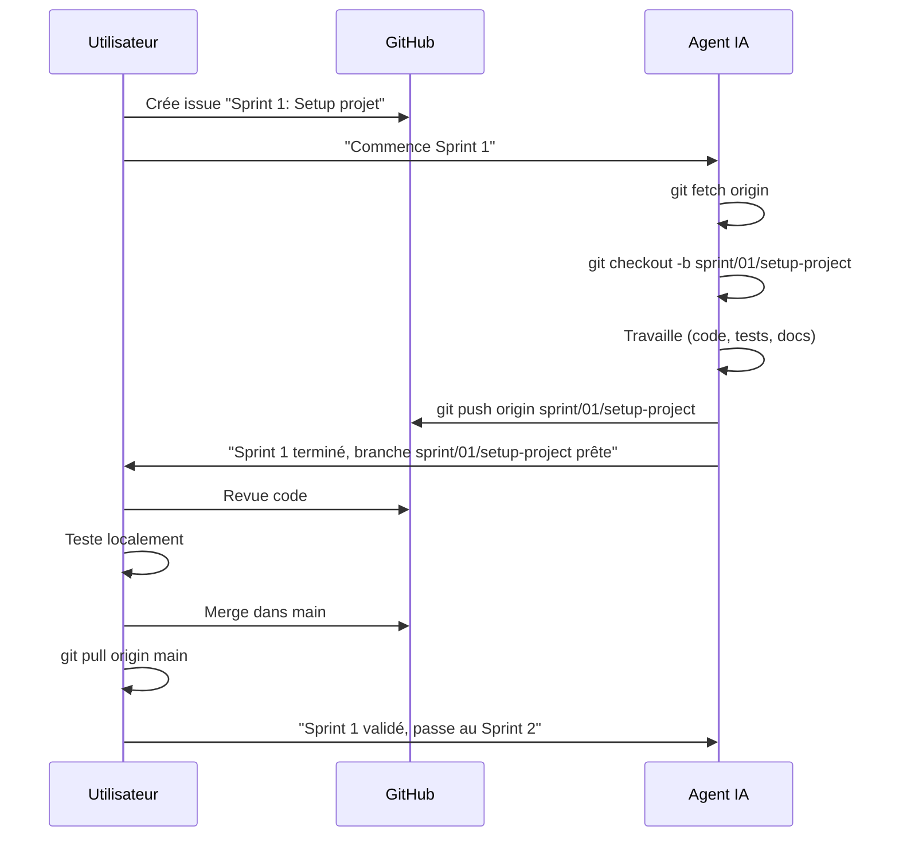

# Guide Git et GitHub — EKTS

**Statut :** ✅ Terminé  
**Date de création :** 21 octobre 2026  
**Dernière mise à jour :** 21 octobre 2026  
**Version :** 1.0  
**Auteur :** Agent EKTS  
**Objectif :** Définir le workflow Git/GitHub pour collaboration agent IA / utilisateur

---

## 1. Objectif du document

Ce document définit :
1. La stratégie de branches Git
2. Le workflow de collaboration entre l'agent IA et l'utilisateur
3. Les conventions de commits
4. La procédure de revue et merge
5. L'interdiction absolue des pull requests
6. Les commandes Git autorisées et interdites

**Contexte opérationnel :**
- L'utilisateur travaille dans VS Code sur son ordinateur
- L'agent IA travaille dans son propre environnement (sandbox Arena)
- Les deux partagent un dépôt GitHub commun
- L'agent peut créer des branches, commits et push, mais JAMAIS de pull requests

---

## 2. Architecture Git

### 2.1 Dépôt GitHub

**Structure :**
```
github.com/{utilisateur}/Engineering-Knowledge-Tooling-System/
├── main                    ← Branche principale (protégée)
├── feature/*               ← Branches fonctionnelles
├── fix/*                   ← Branches de correction
├── docs/*                  ← Branches documentation
└── sprint/*                ← Branches de sprint
```

**Propriétés :**
- **Visibilité** : Privé (recommandé) ou public
- **Protection main** : Merge interdit directement, revue requise
- **Branches protégées** : `main` uniquement

### 2.2 Branches

#### 2.2.1 Branche principale : `main`

**Rôle :** Code stable, toujours fonctionnel  
**Protection :**
- ✅ Push direct interdit
- ✅ Merge via revue uniquement
- ✅ Tests CI requis avant merge

**État :**
- ✅ Tags de release (v1.0.0, v1.1.0, etc.)
- ✅ Historique linéaire (rebase préféré)

#### 2.2.2 Branches fonctionnelles

**Convention de nommage :**
```
agent/sprint-XX-XX            ← agent (session classique)
arena/{session-id}-{slug}     ← agent (session Arena, imposée)
sprint/{numero-sprint}/{description}  ← utilisateur
feature/{description-courte}
fix/{description-courte}
docs/{description-courte}
```

**Exemples :**
```
feature/mvp1-search-engine
feature/mvp2-browser-inspector
fix/sqlite-wal-performance
docs/architecture-technique
sprint/01/setup-project
sprint/02/data-layer
```

**Cycle de vie :**
1. Créée depuis `main` (à jour)
2. Travail isolé (commits atomiques)
3. Push régulier (sauvegarde)
4. Revue par utilisateur
5. Merge dans `main` (après validation)
6. Suppression après merge

### 2.3 Tags

**Convention :**
```
v{major}.{minor}.{patch}
```

**Exemples :**
```
v1.0.0   → MVP-1 terminé
v1.1.0   → MVP-2 terminé
v1.2.0   → MVP-3 terminé
v2.0.0   → Breaking changes
```

**Création :**
```bash
git tag -a v1.0.0 -m "MVP-1: Bibliothèque + Recherche + CLI + MCP"
git push origin v1.0.0
```

---

## 3. Workflow de collaboration

### 3.1 Rôles

**Utilisateur (VS Code local) :**
- ✅ Crée issues et milestones
- ✅ Revue code (branches agent)
- ✅ Merge branches validées
- ✅ Résout conflits complexes
- ✅ Valide sprints

**Agent IA (sandbox Arena) :**
- ✅ Lit documentation et code
- ✅ Crée branches de travail
- ✅ Implémente fonctionnalités
- ✅ Exécute tests
- ✅ Commit et push
- ✅ Signale travaux terminés

### 3.2 Workflow standard



### 3.3 Procédure agent IA

**Étape 1 — Préparation :**
```bash
# Récupérer dernières modifications
git fetch origin

# Vérifier état local
git status
git branch

# Créer branche de travail
git checkout -b sprint/{numero}/{description}
```

**Étape 2 — Travail :**
```bash
# Modifier fichiers
# ...

# Stage modifications
git add .

# Commit atomique
git commit -m "type(scope): description

- Détail 1
- Détail 2

Refs: #123"
```

**Étape 3 — Push :**
```bash
# Push branche
git push origin sprint/{numero}/{description}
```

**Étape 4 — Notification :**
```markdown
## Sprint X terminé

**Branche :** `sprint/X/description`
**Commits :** 5 commits
**Tests :** ✅ Tous passent
**Couverture :** 85%

### Changements
- Fichier 1 modifié
- Fichier 2 ajouté
- Tests ajoutés

### Validation requise
- [ ] Revue code
- [ ] Tests locaux
- [ ] Merge dans main
```

### 3.4 Procédure utilisateur

**Étape 1 — Revue :**
```bash
# Récupérer branche agent
git fetch origin
git checkout sprint/{numero}/{description}

# Voir différences
git diff main...sprint/{numero}/{description}

# Examiner commits
git log --oneline main..sprint/{numero}/{description}
```

**Étape 2 — Test local :**
```bash
# Installer dépendances
npm install

# Exécuter tests
npm test
npm run lint
npm run build
```

**Étape 3 — Merge :**
```bash
# Retourner sur main
git checkout main

# Merge (fast-forward si possible)
git merge --ff-only sprint/{numero}/{description}

# Push
git push origin main
```

**Étape 4 — Nettoyage :**
```bash
# Supprimer branche locale
git branch -d sprint/{numero}/{description}

# Supprimer branche distante
git push origin --delete sprint/{numero}/{description}
```

---

## 4. Conventions de commits

### 4.1 Format

```
type(scope): description courte

Corps optionnel (détails)

Refs: #issue
```

### 4.2 Types

| Type | Usage | Exemple |
|------|-------|---------|
| `feat` | Nouvelle fonctionnalité | `feat(search): add hybrid search engine` |
| `fix` | Correction bug | `fix(sqlite): resolve WAL locking issue` |
| `docs` | Documentation | `docs(architecture): add technical diagram` |
| `style` | Formatage (pas de logique) | `style(code): apply prettier formatting` |
| `refactor` | Refactorisation | `refactor(mcp): extract tool registration` |
| `test` | Tests | `test(search): add recall benchmark` |
| `chore` | Maintenance | `chore(deps): update zod to 3.22.0` |

### 4.3 Exemples

**Bon commit :**
```
feat(mcp): add search_knowledge tool

- Implement hybrid search (FTS5 + sqlite-vec + RRF)
- Add Zod validation for input/output
- Add unit tests (coverage 92%)
- Update MCP server documentation

Refs: #12
```

**Mauvais commit :**
```
update stuff
```

### 4.4 Atomicité

**Principe :** 1 commit = 1 changement logique

**✅ Bon :**
- Commit 1 : Add search engine
- Commit 2 : Add search tests
- Commit 3 : Update documentation

**❌ Mauvais :**
- Commit 1 : Add search engine + tests + docs + fix bug + refactor

---

## 5. Interdiction absolue des pull requests

### 5.1 Règle

**🚫 INTERDIT :**
- ❌ Créer une pull request
- ❌ Demander à un outil de créer une pull request
- ❌ Déclencher un workflow qui crée automatiquement une pull request
- ❌ Contourner cette interdiction

**✅ AUTORISÉ :**
- ✅ Créer des branches
- ✅ Pousser des branches
- ✅ Signaler qu'une branche est prête pour revue
- ✅ L'utilisateur merge manuellement

### 5.2 Justification

**Pourquoi cette interdiction :**
1. **Contrôle total** : L'utilisateur garde le contrôle du merge
2. **Revue manuelle** : Pas d'automatisation dangereuse
3. **Simplicité** : Workflow linéaire, pas de confusion
4. **Sécurité** : Pas de merge automatique sans validation

### 5.3 Alternative

**Workflow alternatif :**
1. Agent pousse branche
2. Agent notifie utilisateur (message, issue comment)
3. Utilisateur revue localement
4. Utilisateur merge manuellement

### 5.4 Dérogation de session — branches `arena/*`

**Contexte :** les sessions de l'agent hébergé (Arena.ai) sont rattachées à **une seule branche imposée** par la plateforme, de la forme `arena/<session-id>-<slug>`. L'agent ne peut ni en changer, ni en créer une autre, ni pousser vers `main`.

**Conséquences pratiques :**
- La convention `agent/sprint-XX-XX` s'applique aux sessions où l'agent peut créer une branche ; en session Arena, la branche `arena/*` en tient lieu.
- Les commits restent **atomiques par sous-sprint** (`feat(sprint-01-01): …`, `feat(sprint-01-02): …`, `feat(sprint-01-03): …`) afin de conserver la traçabilité.
- L'utilisateur récupère la branche dans VS Code et fusionne manuellement après validation (`git merge --ff-only arena/…` si `main` n'a pas divergé, sinon merge commit).
- Aucune pull request n'est créée, y compris depuis la branche `arena/*`.

**Nommage retenu :**

| Usage | Convention |
|-------|------------|
| Agent (session classique) | `agent/sprint-XX-XX` |
| Agent (session Arena, imposée) | `arena/<session-id>-<slug>` |
| Utilisateur | `sprint/XX/description`, `feature/*`, `fix/*`, `docs/*` |

### 5.5 Fusion locale sans pull request

**Procédure utilisateur (VS Code) :**
```bash
git fetch origin
git checkout main
git merge --ff-only origin/arena/<session-id>-<slug>
# si divergence :
# git merge --no-ff origin/arena/<session-id>-<slug>
npm ci
npm run lint && npm run typecheck && npm run build && npm test
git push origin main
```

**Critère de fusion :** CI verte sur la branche + revue locale + tests exécutés. La « revue » du §2.2.1 se fait donc **localement**, sans pull request.

---

## 6. Commandes Git

### 6.1 Commandes autorisées (agent)

| Commande | Usage | Risque |
|----------|-------|--------|
| `git status` | Vérifier état | 🟢 Faible |
| `git fetch` | Récupérer distantes | 🟢 Faible |
| `git checkout` | Changer branche | 🟢 Faible |
| `git checkout -b` | Créer branche | 🟢 Faible |
| `git add` | Stage fichiers | 🟢 Faible |
| `git commit` | Commiter | 🟢 Faible |
| `git push` | Push branche | 🟡 Moyen |
| `git branch` | Lister branches | 🟢 Faible |
| `git log` | Voir historique | 🟢 Faible |
| `git diff` | Voir différences | 🟢 Faible |

### 6.2 Commandes interdites (agent)

| Commande | Raison |
|----------|--------|
| `git push origin main` | 🚫 Push direct sur main interdit |
| `git merge` | 🚫 Merge réservé à l'utilisateur |
| `git rebase` | 🚫 Réécriture historique interdite |
| `git reset --hard` | 🚫 Perte de données possible |
| `git push --force` | 🚫 Écrasement historique interdit |
| `git branch -D` | 🚫 Suppression forcée interdite |
| `gh pr create` | 🚫 Création pull request interdite |

### 6.3 Commandes réservées (utilisateur)

| Commande | Usage |
|----------|-------|
| `git merge` | Merge branches dans main |
| `git rebase` | Réécriture historique (si nécessaire) |
| `git push origin main` | Push direct sur main |
| `gh pr create` | Création pull request (si requis) |

---

## 7. Gestion des conflits

### 7.1 Prévention

**Bonnes pratiques :**
- ✅ Pull régulier (`git fetch`, `git merge origin/main`)
- ✅ Branches courte durée (< 1 semaine)
- ✅ Communication (issues, commentaires)
- ✅ Travail sur fichiers différents si possible

### 7.2 Résolution (utilisateur)

**Si conflit lors du merge :**
```bash
# Checkout main
git checkout main

# Merge (conflits apparaissent)
git merge sprint/01/setup-project

# Voir fichiers en conflit
git status

# Éditer fichiers en conflit
# ...

# Stage résolution
git add .

# Commit merge
git commit -m "merge: resolve conflicts in sprint/01"

# Push
git push origin main
```

### 7.3 Résolution (agent)

**Agent ne résout PAS les conflits :**
- ❌ Agent ne merge pas
- ❌ Agent ne résout pas les conflits de merge
- ✅ Agent signale le conflit à l'utilisateur
- ✅ Agent attend instructions

**Message agent :**
```markdown
## ⚠️ Conflit détecté

**Branche :** `sprint/01/setup-project`
**Conflit avec :** `main`
**Fichiers en conflit :**
- `package.json`
- `src/index.ts`

**Action requise :**
- Revue manuelle par utilisateur
- Résolution des conflits
- Merge dans main
```

---

## 8. Synchronisation

### 8.1 Agent : Récupérer modifications utilisateur

**Avant de commencer travail :**
```bash
# Récupérer dernières modifications
git fetch origin

# Voir branches distantes
git branch -r

# Vérifier main à jour
git log origin/main --oneline -5
```

**Créer branche depuis main à jour :**
```bash
# Checkout main
git checkout main

# Pull dernières modifications
git pull origin main

# Créer nouvelle branche
git checkout -b sprint/02/data-layer
```

### 8.2 Utilisateur : Récupérer travail agent

**Après notification agent :**
```bash
# Récupérer toutes branches
git fetch origin

# Voir branches distantes
git branch -r

# Checkout branche agent
git checkout sprint/02/data-layer

# Voir différences avec main
git diff main...sprint/02/data-layer
```

---

## 9. Configuration initiale

### 9.1 Dépôt GitHub

**Création (utilisateur) :**
```bash
# Local
cd Engineering-Knowledge-Tooling-System
git init
git add .
git commit -m "initial: EKTS project structure"

# GitHub
gh repo create Engineering-Knowledge-Tooling-System --private --source=. --push
```

**Protection branche main (utilisateur) :**
```bash
# GitHub UI ou API
gh api repos/{user}/Engineering-Knowledge-Tooling-System/branches/main/protection \
  -X PUT \
  -f required_status_checks=null \
  -f enforce_admins=true \
  -f required_pull_request_reviews=null \
  -f restrictions=null
```

### 9.2 Configuration agent

**Credentials (utilisateur configure) :**
```bash
# GitHub CLI
gh auth login

# Git config
git config --global user.name "Agent IA"
git config --global user.email "agent@ekts.local"
```

**Permissions agent :**
- ✅ Lecture dépôt
- ✅ Écriture branches (pas main)
- ✅ Création branches
- ✅ Push branches
- ❌ Pas de merge
- ❌ Pas de suppression branches protégées

### 9.3 Configuration utilisateur

**VS Code :**
```bash
# Extensions recommandes
code --install-extension dbaeumer.vscode-eslint
code --install-extension esbenp.prettier-vscode
code --install-extension bradlc.vscode-tailwind
```

**Git config :**
```bash
git config --global user.name "Utilisateur"
git config --global user.email "user@example.com"
git config --global pull.rebase true
git config --global push.default current
```

---

## 10. Checklist collaboration

### 10.1 Avant de commencer un sprint

**Agent :**
- [ ] `git fetch origin`
- [ ] `git checkout main && git pull origin main`
- [ ] Créer branche `sprint/{numero}/{description}`
- [ ] Vérifier issue GitHub associée

**Utilisateur :**
- [ ] Issue créée avec critères d'acceptation
- [ ] Branche `main` à jour
- [ ] Notification envoyée à l'agent

### 10.2 Pendant le sprint

**Agent :**
- [ ] Commits atomiques (1 changement logique)
- [ ] Messages de commit conventionnels
- [ ] Tests exécutés avant commit
- [ ] Push régulier (sauvegarde)

**Utilisateur :**
- [ ] Disponible pour questions
- [ ] Revue issues/notifications

### 10.3 Fin de sprint

**Agent :**
- [ ] Tous tests passent (`npm test`)
- [ ] Couverture > 80% (`npm run coverage`)
- [ ] Lint passe (`npm run lint`)
- [ ] Documentation mise à jour
- [ ] Push branche finale
- [ ] Notification utilisateur

**Utilisateur :**
- [ ] Revue code (`git diff`)
- [ ] Tests locaux (`npm test`)
- [ ] Merge dans `main`
- [ ] Push `main`
- [ ] Notification agent (sprint validé)
- [ ] Suppression branche sprint

---

## 11. Dépannage

### 11.1 Agent ne peut pas push

**Erreur :** `permission denied`  
**Solution :**
```bash
# Vérifier authentification
gh auth status

# Re-authentifier
gh auth login
```

### 11.2 Conflits après push agent

**Erreur :** `non-fast-forward updates were rejected`  
**Solution :**
```bash
# Agent : récupérer main
git fetch origin
git checkout main
git pull origin main

# Rebase branche sprint
git checkout sprint/01/setup-project
git rebase main

# Push avec force (DANGEREUX, seulement si seul sur branche)
git push --force-with-lease origin sprint/01/setup-project
```

**⚠️ Attention :** `--force-with-lease` uniquement si agent est seul sur la branche.

### 11.3 Branche supprimée par erreur

**Solution :**
```bash
# Voir reflog
git reflog

# Restaurer branche
git checkout -b sprint/01/setup-project abc1234
```

---

## 12. Références

### 12.1 Documentation Git

- **Git Book** : https://git-scm.com/book
- **GitHub Docs** : https://docs.github.com
- **Conventional Commits** : https://www.conventionalcommits.org

### 12.2 Outils

- **GitHub CLI** : https://cli.github.com
- **GitKraken** : https://www.gitkraken.com (optionnel)
- **Sourcetree** : https://www.sourcetreeapp.com (optionnel)

### 12.3 Workflows

- **GitHub Flow** : https://docs.github.com/en/get-started/quickstart/github-flow
- **Git Flow** : https://nvie.com/posts/a-successful-git-branching-model/

---

**Document rédigé le 21 octobre 2026 — PARTIE I du projet EKTS**  
**Statut : ✅ Guide de collaboration Git/GitHub**
